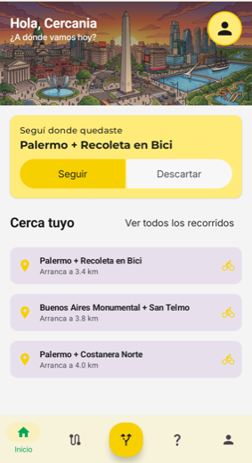
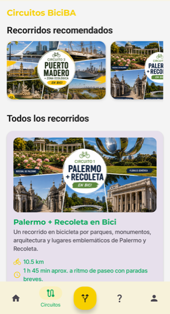
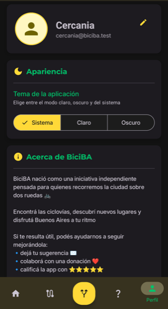

# BiciBA

**Descubrí Buenos Aires sobre dos ruedas.**

Las ciclovías de la Ciudad sobre el mapa, circuitos turísticos para recorrerlas
y una guía que te acompaña punto por punto.

 

  

 

> Este repositorio es **el sitio público de BiciBA**. Se sirve en la raíz de
> `https://artemiod.github.io` y aloja la página del proyecto, la política de privacidad y el
> `app-ads.txt` que Google AdMob exige. Más abajo está el detalle de por qué todo vive junto.

 

## 📱 La aplicación

| Inicio | Circuitos | Detalle |
|:---:|:---:|:---:|
|  |  |  |
|  |  |  |

Arriba el tema claro, abajo el oscuro. El tema lo elegís vos, no el sistema.

 

| En pleno recorrido | Tu perfil |
|:---:|:---:|
|  |  |

 

## ✨ Qué hace

🗺️ **Ciclovías sobre el mapa** — las de toda la Ciudad, dibujadas sobre Google Maps y disponibles
sin conexión una vez descargadas.

🚲 **Circuitos turísticos** — cada uno con su distancia, duración estimada, dificultad y puntos de
interés, ilustrados con su propio mapa.

🧭 **Una guía que acompaña** — durante el recorrido señala hacia el próximo punto pendiente, dice a
qué distancia está y avisa al llegar. El recorrido sobrevive a cerrar la aplicación: al volver,
seguís donde quedaste.

📍 **Lo que tenés más cerca** — el inicio ordena los circuitos por cuál arranca más cerca tuyo, y el
orden no salta con cada lectura del GPS.

🌙 **Claro y oscuro** — hasta las ilustraciones cambian: de día el Obelisco al atardecer, de noche
la ciudad iluminada.

 

## 🔒 Qué datos usa, y para qué

La [política de privacidad](https://artemiod.github.io/PrivacidadBiciBa/) no describe la aplicación
en general: dice qué recoge y por qué. Esta es la correspondencia completa.

| Dato | Función que lo necesita | Dónde queda |
|---|---|---|
| Nombre, correo e identificador | Crear la cuenta e iniciar sesión | Firebase |
| Foto de perfil | Mostrarla en el perfil, solo si subís una | Firebase Storage |
| **Ubicación** | Ubicarte en el mapa, ordenar los circuitos por cercanía y guiarte | 🔒 **Solo en tu teléfono** |
| Diagnóstico y uso | Detectar fallos y entender de forma agregada cómo se usa | Crashlytics y Analytics |
| Identificador de publicidad | Mostrar los anuncios que sostienen el proyecto | AdMob |
| Tema, recorrido en curso y mapa descargado | Recordar tu preferencia y funcionar sin conexión | 🔒 **Solo en tu teléfono** |

**La ubicación no sale del teléfono.** No se escribe en ningún servidor ni se comparte: el
dispositivo la usa mientras la aplicación está abierta y ahí termina. Tampoco se accede a ella en
segundo plano.

Podés **eliminar tu cuenta vos mismo** desde la aplicación, en *Perfil → Eliminar cuenta*.

 

## 🗂️ Qué hay en este repositorio

| Ruta | Qué es |
|---|---|
| [`/`](https://artemiod.github.io/) | La página del proyecto: qué hace la aplicación, capturas y enlaces. |
| [`/PrivacidadBiciBa/`](https://artemiod.github.io/PrivacidadBiciBa/) | La política de privacidad, enlazada desde Google Play y desde la propia app. |
| [`/app-ads.txt`](https://artemiod.github.io/app-ads.txt) | La declaración de AdMob. |

Son páginas estáticas: sin dependencias ni compilación, se abren tal cual.

**Por qué todo vive junto.** Por `app-ads.txt`: AdMob lo exige para seguir publicando anuncios, y el
estándar obliga a servirlo en la **raíz del dominio** que figura como sitio web del desarrollador en
la ficha de Google Play. El rastreador pide `https://artemiod.github.io/app-ads.txt` y ninguna otra
dirección, así que una subcarpeta no sirve. Ya que la raíz tenía que existir igual, aloja también la
página del proyecto y la política.

La política conserva a propósito la ruta `/PrivacidadBiciBa/`, que es la que quedó compilada dentro
de las versiones de la aplicación ya publicadas: cambiarla dejaría ese enlace roto en los teléfonos
que no se actualicen.

**Mantenerla.** La política describe lo que la aplicación hace de verdad, así que se actualiza junto
con la app: al agregar un permiso, un SDK que procese datos o una función que guarde algo nuevo, hay
que reflejarlo ahí y cambiar la fecha de "Última actualización". La tabla de más arriba es la que
conviene repasar en cada cambio.

 

## 📬 Contacto

Dudas sobre el tratamiento de datos, o cualquier consulta sobre la aplicación:
**artemio.dev.mobile@gmail.com**

¿Te resulta útil? Podés **[invitarnos un cafecito](https://cafecito.app/biciba)** ❤️

 

---

BiciBA es un proyecto independiente · Hecho para disfrutar Buenos Aires sobre dos ruedas 🚲

